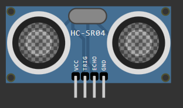

# Ultrasonic-distance-instrument

## 🎯 Project Goal
Design and create a functional parking sensor model using a Raspberry Pi Pico W microcontroller. The system displays the precise distance from an obstacle on an LCD screen and provides an audible warning as the distance changes.

---

## 👥 Team Members
> Marek Šádek,
> Marek Gláser,
> Dávid Szalay

---

## 🛠️ Hardware & Components

### 1. [Raspberry Pi Pico W](https://pip-assets.raspberrypi.com/categories/686-raspberry-pi-pico-w/documents/RP-008312-DS-2-pico-w-datasheet.pdf)

Chosen as our main microcontroller processing unit for its low cost, dual-core processor, and built-in wireless connectivity capabilities.

---

### 2. [HC-SR04 Ultrasonic Distance Sensor](https://cdn.sparkfun.com/datasheets/Sensors/Proximity/HCSR04.pdf) (2×)

Provides accurate, non-contact distance measurement from 2 cm to 400 cm using high-frequency sonar waves to detect nearby obstacles.

Hardware - Raspberry Pi Pico W Microcontroller, 2 x HC-SR04 Ultrasonic Sensor, Nokia 5110 LCD SPI Display, HW-508 v0.2 Passive Buzzer

Project Goal: Design and create a functional parking sensor model using raspberry microcontroller, which shows the precise current distance from the object in the way on the display, additional sound warning

