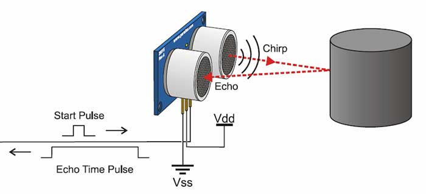
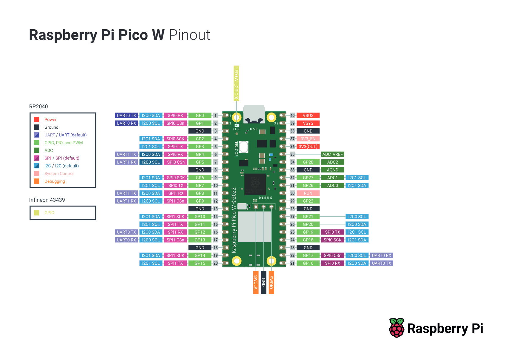
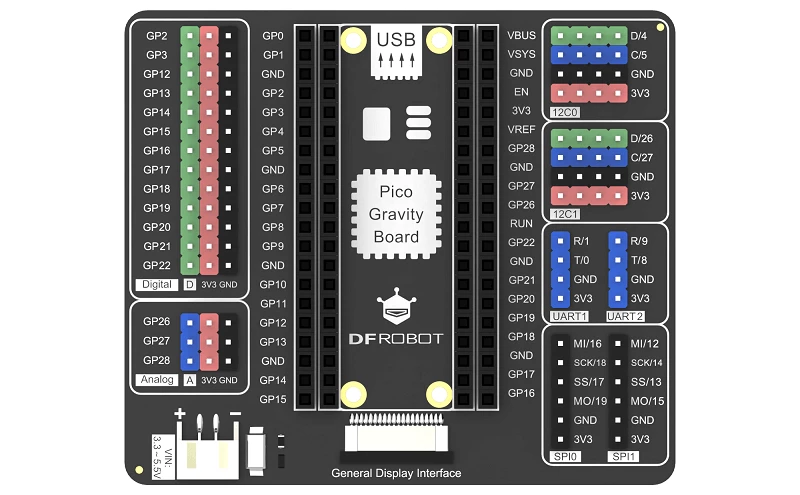
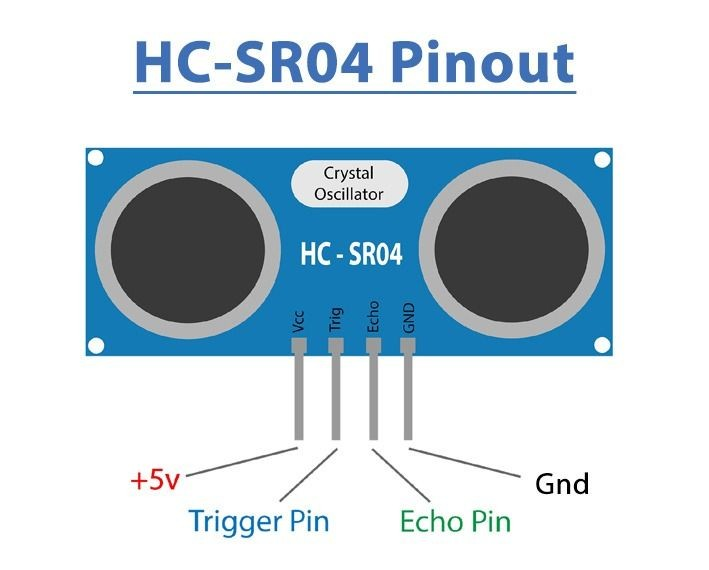
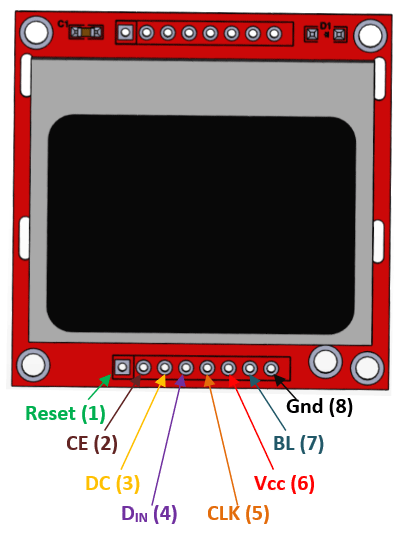
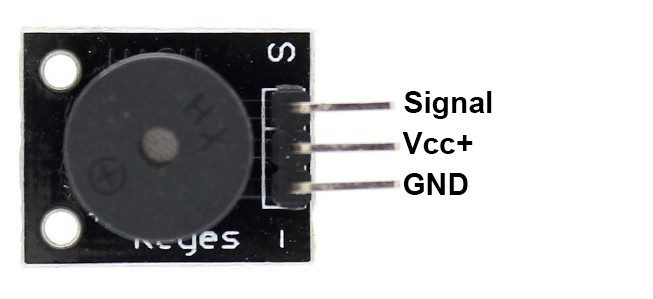

# Ultrasonic Parking Sensor

A parking sensor model built on a **Raspberry Pi Pico W** in **MicroPython**. Two ultrasonic sensors measure the distance to an obstacle on the left and right side, a Nokia 5110 display shows the distance, and a passive buzzer beeps faster as the obstacle gets closer.

---

## Team

| Member | Responsibility |
|---|---|
| [Marek Šádek](https://github.com/SadekMarek) | TBD |
| [Marek Gláser](https://github.com/glasermarek) | TBD |
| [Dávid Szalay](https://github.com/Szalo03) | TBD |

---

## How it works

Two HC-SR04 sensors are mounted side by side, like on a car bumper. They are triggered alternately, because triggering them at the same time would make them pick up each other's echo. Each reading is filtered to remove random jumps.

  

When the Pico sends a short **Start Pulse** (`TRIG`), the sensor emits an ultrasonic burst (**Chirp**) that travels through the air, bounces off an obstacle, and returns as an **Echo** to the receiver.

At the same time, the sensor outputs an **Echo Time Pulse** (`ECHO`) whose HIGH duration $t$ equals the total travel time of the sound wave from emission to reception. Since the wave travels to the obstacle and back (twice the distance), the Pico calculates the one-way distance $d$ using the speed of sound in air ($v \approx 343\text{ m/s}$, or $0.0343\text{ cm/}\mu\text{s}$):

$$d = \frac{t \times 0.0343}{2}\text{ [cm]}$$

where $t$ is the **Echo Time Pulse** duration in microseconds ($\mu\text{s}$) measured by our pin interrupt.

**Display** – shows the distance in cm for the left and right side, each with a bar that fills up as the obstacle gets closer. When no echo is received or the value is out of range, `---` is shown instead of a wrong number.

**Buzzer** – follows the closer of the two sensors:
- far away: silent,
- getting closer: beeping gets faster and the tone gets higher,
- below the critical distance: continuous tone.

**Button**

| Mode | Action | Function |
|---|---|---|
| Normal | Short press | Mute / unmute the buzzer |
| Normal | Long press (> 1 s) | Enter STOP setting mode |
| STOP setting | Long press | Save the current distance as the STOP distance |
| STOP setting | Short press | Cancel without saving |

In STOP setting mode the measured distance and the text `STOP` blink on the display. The user moves to the distance where the car should stop and confirms it with a long press; `SAVED` is shown for a moment. The closer of the two sensors is used. If nothing is pressed for 15 s, the mode is cancelled without saving. In normal mode the display then shows `STOP` when this distance is reached (e.g. parking in a garage).

The STOP distance is stored in the Pico's flash, so it stays saved after a restart.

---

## Components

| Component | Qty | Purpose |
|---|---|---|
| [Raspberry Pi Pico W](https://pip-assets.raspberrypi.com/categories/686-raspberry-pi-pico-w/documents/RP-008312-DS-2-pico-w-datasheet.pdf) | 1 | Main controller |
| [DFRobot Gravity Expansion Board for Pico (DFR0848)](https://wiki.dfrobot.com/dfr0848/) | 1 | Plug-in connectors instead of a breadboard |
| [HC-SR04 ultrasonic sensor](https://cdn.sparkfun.com/datasheets/Sensors/Proximity/HCSR04.pdf) | 2 | Distance measurement, 2–400 cm |
| [Nokia 5110 LCD, SPI](https://cdn.sparkfun.com/assets/b/1/b/e/f/Nokia5110.pdf) | 1 | 84 × 48 px display |
| [HW-508 passive buzzer](https://www.datasheethub.com/datasheets/others/hw-508-small-passive-buzzer-module-datasheet.pdf) | 1 | Sound warning, tone set by PWM |
| Push button | 1 | Mute, STOP distance setting |

**Sensor supply:** The Pico pins accept max. 3.3 V and the sensor's ECHO output has the same voltage as its supply. We will first test the sensors on 3.3 V. If they do not measure reliably, we will power them from VBUS (5 V) and connect ECHO through a 1 kΩ / 2 kΩ voltage divider.

Component pinouts

---

## Block diagram

*To be added.*

---

## Pin assignment

| Device | Signal | GPIO | Pico pin |
|---|---|---|---|
| Nokia 5110 | CLK | GP18 (SPI0) | 24 |
| | DIN | GP19 (SPI0) | 25 |
| | CE | GP17 | 22 |
| | DC | GP20 | 26 |
| | RST | GP21 | 27 |
| | BL (backlight) | GP22 | 29 |
| HC-SR04 left | TRIG / ECHO | GP2 / GP3 | 4 / 5 |
| HC-SR04 right | TRIG / ECHO | GP12 / GP13 | 16 / 17 |
| Buzzer | SIG (PWM) | GP14 | 19 |
| Button | to GND, internal pull-up | GP15 | 20 |

---

## Timing plan

The program uses `uasyncio` tasks, so a slow display update does not delay the measurement.

| Task | Interval |
|---|---|
| Distance measurement | every 60 ms, sensors alternate (each side ≈ every 120 ms) |
| Button check | every 20–50 ms |
| Display update | every 100–250 ms |
| Buzzer | beep interval set by the distance |

The ECHO pulse is measured with a pin interrupt that only stores the time of the rising and falling edge. The distance is then calculated in the measurement task.

---

## Progress

**Week 1** – Topic chosen, components selected, functionality and button control designed, pin assignment and timing plan drafted.
