# Ultrasonic Parking Sensor

A rear parking sensor model built on a **Raspberry Pi Pico W** in **MicroPython**. Two ultrasonic sensors on the rear bumper measure the distance to an obstacle on the left and right side. A Nokia 5110 display shows both distances and a car-style distance indicator, and a passive buzzer beeps faster as the obstacle gets closer. A simplified **rear collision warning** detects an obstacle approaching fast from behind and warns with red hazard LEDs, a message on the display and an alarm sound.

---

## Team

| Member | Responsibility |
|---|---|
| [Marek Šádek](https://github.com/SadekMarek) | Project design, hardware testing, software development |
| [Marek Gláser](https://github.com/glasermarek) | Project design, hardware testing, software development |
| [Dávid Szalay](https://github.com/Szalo03) | Project design, hardware testing, software development |

---

## How it works

Two HC-SR04 sensors are mounted side by side on the rear bumper. They are triggered alternately, because triggering them at the same time would make them pick up each other's echo. Each reading is filtered by a median of the last 3 readings to remove random jumps.

  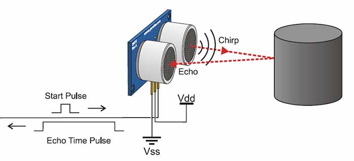 
  Source: Beijing Ultrasonic, <a href="https://www.bjultrasonic.com/how-do-ultrasonic-sensors-work/">How Do Ultrasonic Sensors Work</a>

When the Pico sends a short **Start Pulse** (`TRIG`), the sensor emits an ultrasonic burst (**Chirp**) that travels through the air, bounces off an obstacle, and returns as an **Echo** to the receiver.

At the same time, the sensor outputs an **Echo Time Pulse** (`ECHO`) whose HIGH duration $t$ equals the total travel time of the sound wave from emission to reception. Since the wave travels to the obstacle and back (twice the distance), the Pico calculates the one-way distance $d$ using the speed of sound in air ($v \approx 343\text{ m/s}$, or $0.0343\text{ cm/}\mu\text{s}$):

$$d = \frac{t \times 0.0343}{2}\text{ [cm]}$$

where $t$ is the **Echo Time Pulse** duration in microseconds ($\mu\text{s}$) measured by our pin interrupt.

### Display

- **Top:** distance in cm from the left and the right sensor (`---` when there is no valid echo).
- **Middle:** a distance indicator above each half of the bumper, like in a car. Five bars per side, the nearest one at the bumper is the smallest. The bar for the obstacle's current distance zone is drawn bold, the others are thin lines. The zones from the bumper up are ≤ 8, 9–20, 21–40, 41–65 and 66–100 cm; above 100 cm no bar is bold.
- **Bottom:** the rear bumper with tail lights, seen from above; `MUTE` is shown in it when the buzzer is muted.
- **STOP:** a big `STOP` over the middle of the screen when the saved STOP distance is reached.

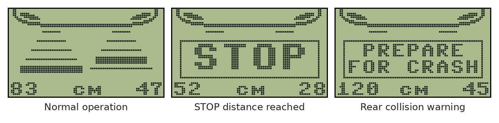

### Buzzer

Like in a car, the tone (440 Hz) and the length of one beep (70 ms) stay the same, only the pause between beeps changes. It gets shorter smoothly with the distance, without steps:

| Distance | Sound |
|---|---|
| above 100 cm | silent |
| 100 cm → 9 cm | beeping, the pause goes linearly from 800 ms down to about 100 ms |
| 8 cm and closer | continuous tone |

Both borders (100 cm and 8 cm) have a 2 cm hysteresis, so the sound does not switch back and forth when the obstacle stays right at a border. When the saved STOP distance is reached, the buzzer plays a continuous tone even if the obstacle is farther than 8 cm.

### Button

| Mode | Action | Function |
|---|---|---|
| Normal | Short press | Mute / unmute the buzzer |
| Normal | Long press (> 1 s) | Enter STOP setting mode |
| STOP setting | Long press | Save the current distance as the STOP distance |
| STOP setting | Short press | Delete the saved STOP distance (if none is saved: back without change) |
| Crash message | Any press | Confirm the crash message |

In STOP setting mode the current distance (the closer of the two sensors) blinks on the display and the buzzer is silent. After saving, `SAVED` and the distance are shown for a moment, after deleting `STOP deleted`. If nothing is pressed for 15 s, the mode is cancelled without a change. The STOP distance is stored in `settings.json` in the Pico's flash, so it stays saved after a restart.

### Rear collision warning

From the last 4 readings of each sensor (about 0.4 s) the approach speed is computed by a least-squares line fit, which is much less noisy than the difference of two readings. Together with the distance it gives the time to collision $TTC = d / v$.

| Level | Condition | Reaction |
|---|---|---|
| Warning | approaching faster than 40 cm/s and TTC < 3 s | red hazard LEDs blink |
| Danger | still fast and closer than 60 cm | `PREPARE FOR CRASH` blinks, LEDs and backlight blink fast, alarm sound (also when muted) |
| Crash | the obstacle reaches the bumper (< 5 cm), or the sensor loses it in the Danger level closer than 30 cm | `CRASH` and `eCall 112` for 5 s (longer while the obstacle stays at the bumper), LEDs keep blinking |

A normal parking approach (slower than 40 cm/s) does not trigger the warning. When the obstacle stops or slows down, the warning ends after 1 s. A jump of more than 40 cm between two readings (e.g. a hand put in front of the sensor from the side) starts the speed calculation again, so it is not taken as a fast approach.

**Limitation:** this is a small-scale model. Real systems use radar with a range of tens of metres; the HC-SR04 measures only up to about 4 m, so a real car at 50 km/h would cross the whole range in 0.3 s. The sensor also measures only the relative speed, so it cannot tell whether our car or the other object is moving.

---

## Components

| Component | Qty | Purpose |
|---|---|---|
| [Raspberry Pi Pico W](https://pip-assets.raspberrypi.com/categories/686-raspberry-pi-pico-w/documents/RP-008312-DS-2-pico-w-datasheet.pdf) | 1 | Main controller |
| [DFRobot Gravity Expansion Board for Pico (DFR0848)](https://wiki.dfrobot.com/dfr0848/) | 1 | Plug-in connectors instead of a breadboard |
| [HC-SR04 ultrasonic sensor](https://cdn.sparkfun.com/datasheets/Sensors/Proximity/HCSR04.pdf) | 2 | Distance measurement, 2–400 cm |
| [Nokia 5110 LCD, SPI](https://cdn.sparkfun.com/assets/b/1/b/e/f/Nokia5110.pdf) | 1 | 84 × 48 px display |
| [HW-508 passive buzzer](https://www.datasheethub.com/datasheets/others/hw-508-small-passive-buzzer-module-datasheet.pdf) | 1 | Sound warning, tone set by PWM |
| [Push button](Images/Push_Button.png) | 1 | Mute, STOP distance setting |
| Red LED with a 330 Ω series resistor | 2 | Hazard lights of the rear collision warning |
| Resistor 1 kΩ | 2 | ECHO voltage divider |
| Resistor 2 kΩ | 2 | ECHO voltage divider |

**Sensor supply:** Our HC-SR04 modules are the original 5 V version and do not work reliably on 3.3 V, so they are powered from VBUS (5 V, available when the Pico is powered over USB). The ECHO output then also has 5 V, while the Pico pins accept max. 3.3 V. Each ECHO is therefore connected through a voltage divider: 1 kΩ between ECHO and the GPIO pin, 2 kΩ between the GPIO pin and GND, which gives 5 V · 2/3 ≈ 3.3 V. TRIG is connected directly. The divider was verified on real hardware.

**Hazard LEDs:** both red LEDs are driven by one pin (GP26) in the active-high configuration: the anode is connected to the GPIO through the resistor and the cathode to GND, so the LEDs light when the pin is `1`. Each LED has its own 330 Ω series resistor, which limits the current to about (3.3 V − 2.0 V) / 330 Ω ≈ 4 mA per LED.

Component pinouts

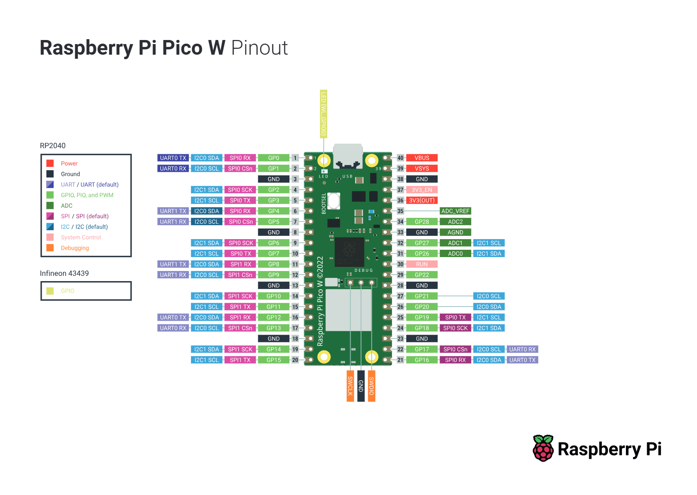

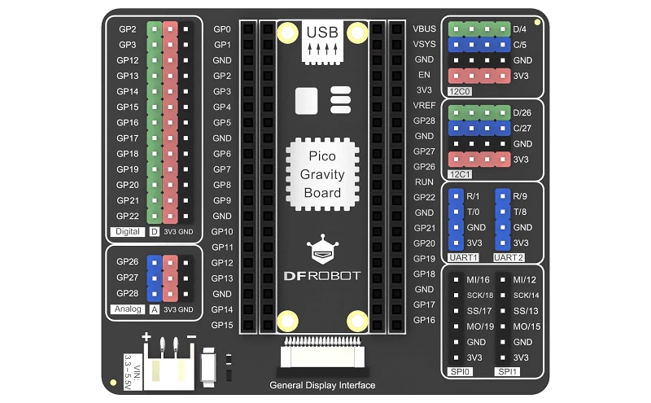

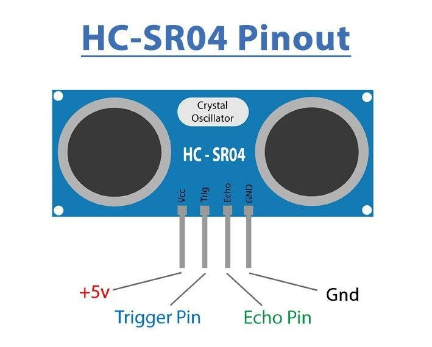

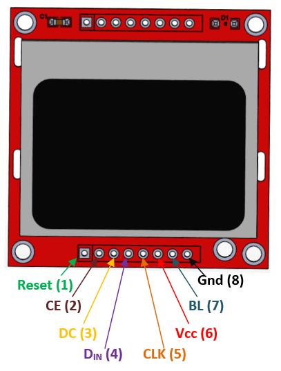

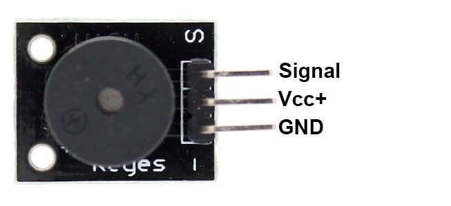

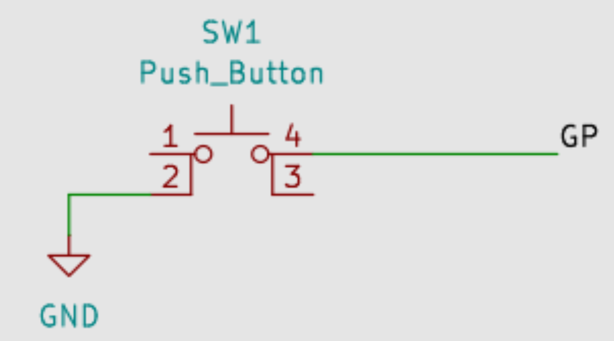

---

## Schematic

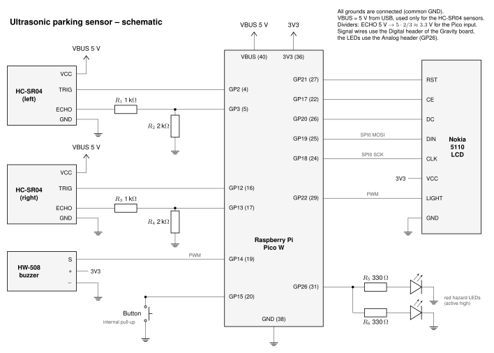

---

## Pin assignment

All signal wires use the **Digital** header on the left side of the Gravity board (each row has signal / 3V3 / GND), the hazard LEDs use the **Analog** header (GP26). Only the sensor supply comes from the VBUS pin.

| Device | Signal | GPIO | Pico pin | Supply |
|---|---|---|---|---|
| Nokia 5110 | CLK | GP18 (SPI0 SCK) | 24 | VCC → 3V3, GND → GND |
| | DIN | GP19 (SPI0 MOSI) | 25 | |
| | CE | GP17 | 22 | |
| | DC | GP20 | 26 | |
| | RST | GP21 | 27 | |
| | LIGHT (backlight) | GP22 | 29 | |
| HC-SR04 left | TRIG | GP2 | 4 | VCC → VBUS (pin 40), GND → GND |
| | ECHO (via divider) | GP3 | 5 | |
| HC-SR04 right | TRIG | GP12 | 16 | VCC → VBUS (pin 40), GND → GND |
| | ECHO (via divider) | GP13 | 17 | |
| Buzzer | S (PWM) | GP14 | 19 | + → 3V3, − → GND |
| Button | to GND, internal pull-up | GP15 | 20 | |
| Hazard LEDs (2×) | anode via 330 Ω (active high) | GP26 | 31 | cathode → GND |

GP16 (SPI0 MISO) is not used, because the display only receives data. The SPI driver still assigns it to SPI0, so the LEDs use GP26.

---

## Software structure

The files in [`src/`](src/) are saved on the Pico. [`main.py`](src/main.py) starts automatically after power-on.

| File | Class | Purpose |
|---|---|---|
| [`main.py`](src/main.py) | – | Creates all components, runs the uasyncio tasks, application modes and drawing |
| [`nokia5110.py`](src/nokia5110.py) | `PCD8544` | Display driver based on `framebuf`, enlarged text |
| [`ultrasonic.py`](src/ultrasonic.py) | `UltrasonicSensor` | TRIG pulse, ECHO time by a pin interrupt, median filter, distance in cm |
| [`buzzer.py`](src/buzzer.py) | `Buzzer` | PWM tone, pause between beeps by distance, continuous tone at STOP, mute; zones for the display bars |
| [`button.py`](src/button.py) | `Button` | Debounce, short / long press |
| [`led.py`](src/led.py) | `Led` | Hazard LEDs |
| [`collision.py`](src/collision.py) | `CollisionWarning` | Approach speed, time to collision, warning levels (logic only, no hardware) |

Only built-in MicroPython modules are used: `machine`, `time`, `framebuf`, `uasyncio`, `json`, `micropython`.

### Tests

Each component has its own test in [`tests/`](tests/), run from Thonny with the class files saved on the Pico. The expected result is described at the top of each file.

| Test | Tests |
|---|---|
| [`test_ultrasonic.py`](tests/test_ultrasonic.py) | Both sensors, raw and filtered distance |
| [`test_display.py`](tests/test_display.py) | Display text and drawing |
| [`test_buzzer.py`](tests/test_buzzer.py) | Tone and beeping at several distances |
| [`test_button.py`](tests/test_button.py) | Short / long press, debounce |
| [`test_led.py`](tests/test_led.py) | Hazard LEDs on, off, blinking |
| [`test_collision.py`](tests/test_collision.py) | Approach speed and warning levels with the left sensor |
| [`prototype.py`](tests/prototype.py) | First prototype from week 2 (all in one file) |

---

## Timing plan

The program runs five `uasyncio` tasks, so a slow display update does not delay the measurement. The interrupt handler only stores the time of the ECHO edges, all calculations run in the tasks.

| Task | Interval | Responsibility |
|---|---|---|
| ECHO interrupt | on each edge | Stores the time of the rising and falling edge |
| `measure_task` | 60 ms, sensors alternate (each side every 120 ms) | Trigger a sensor, compute and filter the distance, update the collision warning |
| `button_task` | 20 ms | Read the button, switch the modes |
| `buzzer_task` | 20 ms | Beeping by distance, STOP tone, collision alarm |
| `light_task` | 50 ms | Hazard LEDs and display backlight blinking |
| `display_task` | 150 ms | Redraw the screen |

---

## Progress

**Week 1** – Topic chosen, components selected, functionality and button control designed, pin assignment and timing plan drafted.

**Week 2** – First prototype tested on real hardware ([`tests/prototype.py`](tests/prototype.py)): one HC-SR04 sensor with the ECHO voltage divider, Nokia 5110 display, buzzer and button. The display showed the measured distance, the buzzer beeped faster as the obstacle got closer and the button muted the buzzer. Schematic and planned software structure added.

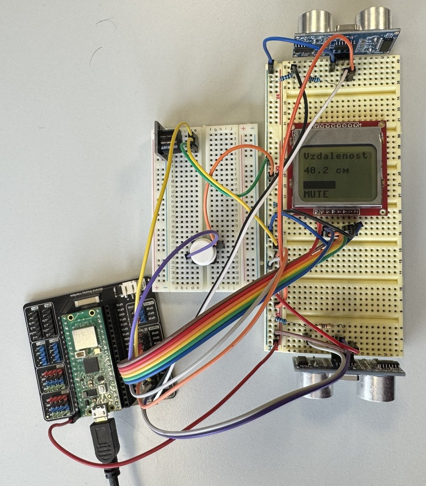

**Week 3** – Code split into reusable classes in [`src/`](src/) with a test for each component in [`tests/`](tests/); the tests of the sensors, display, buzzer and button passed on real hardware. Main program with `uasyncio` tasks tested on hardware: both sensors measured alternately, distances and bars on the display, beeping by distance, mute. Then added: STOP distance setting (save / delete, stored in flash), new car-style display layout, beeping in distance zones and the rear collision warning with hazard LEDs (hardware testing in progress).

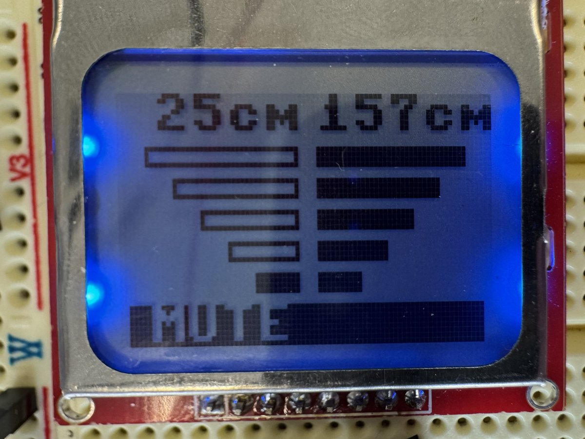

